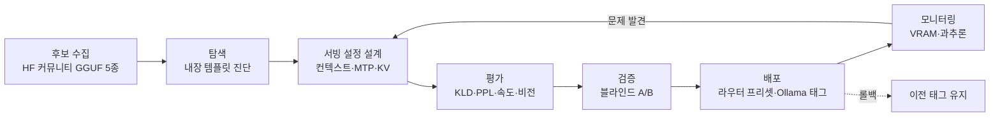
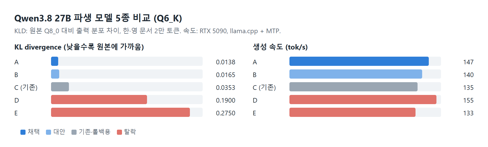
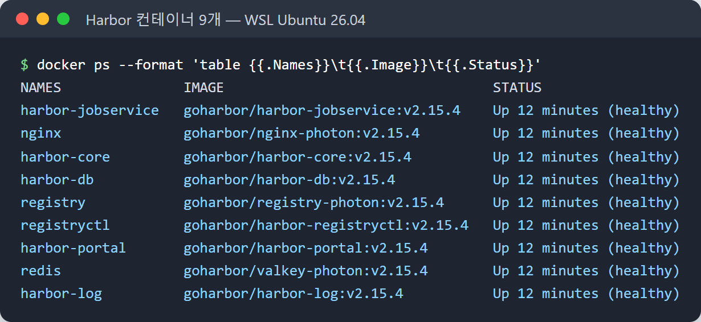
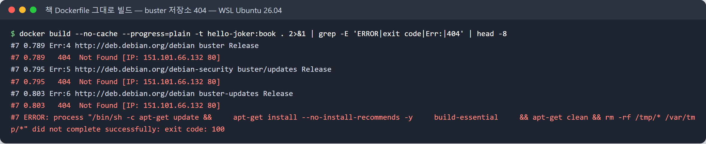
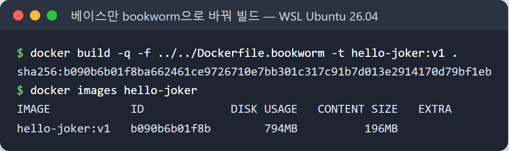
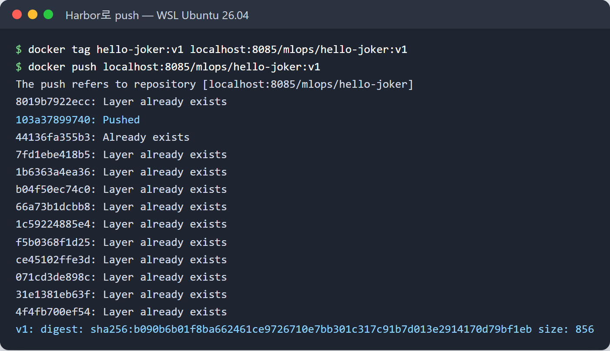
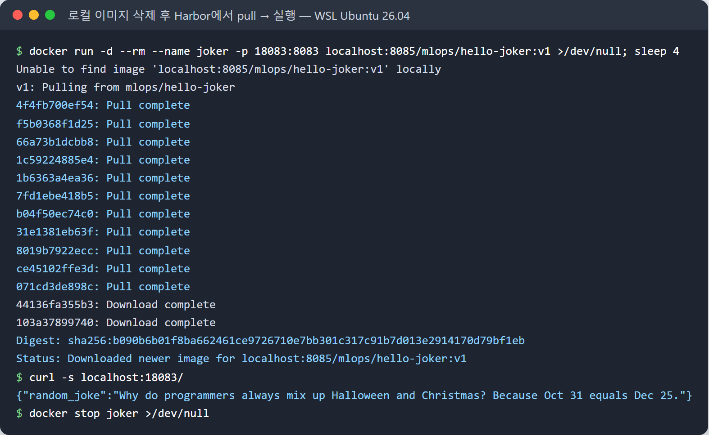
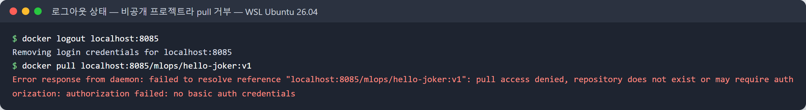
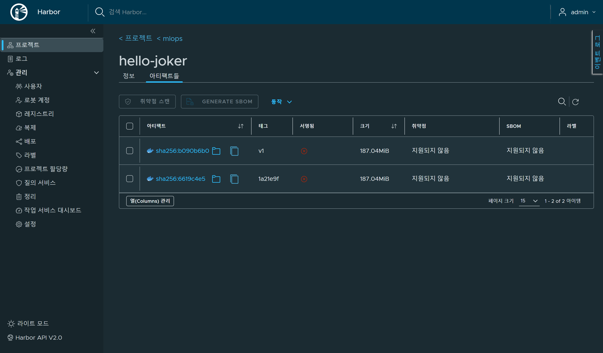
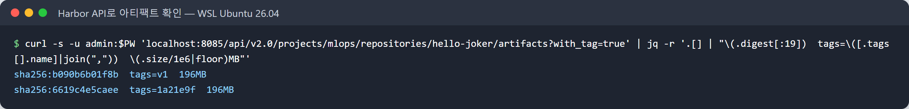

# 집에서 LLM 하나 바꾸는 데도 MLOps 생명주기가 다 들어 있었다

> 머신러닝 플랫폼 엔지니어링 스터디 1주차 과제 — "MLOps/LLMOps 운영 경험 중 기술 내용 위주로 정리"
> 교재: *Machine Learning Platform Engineering* (Manning) 1·2장

## 들어가며

1주차에 1·2장을 읽으면서 "MLOps는 한 번 돌리고 끝나는 파이프라인이 아니라 반복되는 루프"라는 말이 계속 나왔습니다.
읽다 보니 얼마 전 집에서 한 작업이 떠올랐습니다. RTX 5090 한 장으로 돌리는 로컬 LLM(Qwen3.8 27B 계열)을
다른 파생 모델로 교체한 일인데, 돌이켜 보니 2.1절의 생명주기 단계를 거의 그대로 밟았습니다.
학습(training)은 직접 하지 않았지만, **"모델을 고르고, 평가하고, 배포하고, 문제를 발견해 고치는"** 과정은 같았습니다.

이 글은 그 교체 과정을 책의 2.1.1~2.1.7 단계에 맞춰 정리하고,
마지막에 2.5절의 성숙도 단계로 제 환경이 어디쯤인지 평가해 본 기록입니다.

### 환경

| 구성 | 내용 |
|---|---|
| GPU | RTX 5090 32GB |
| 서빙 | llama.cpp 서버(라우터 모드, 요청한 모델로 자동 교체) + Ollama |
| 클라이언트 | 코딩 에이전트(OpenCode, Codex), 사진·영상·음성 질의 CLI |
| 후보 | Hugging Face 커뮤니티 GGUF 5종 (Q6_K 양자화 기준) |

## 전체 흐름



## 2.1.1 데이터 수집 — 무엇으로 비교할 것인가

모델을 직접 학습하지 않으니 "데이터"는 두 가지였습니다.

1. **후보 모델 자체**: 같은 베이스(Qwen3.8 27B)를 커뮤니티가 각자 파인튜닝·양자화한 GGUF 5종.
   HF 좋아요·다운로드 순위가 높은 순으로 골랐습니다.
2. **평가용 데이터**: 한국어·영어 로컬 문서 2만 토큰(2048 × 10), 블라인드 비교용 질문 12개,
   비전 검증용 이미지("SEVEN 7"이 적힌 PNG, 도형 개수 세기 이미지)

책에서 "평가 데이터는 훈련에 쓰지 않은 것을 따로 떼어 둬야 한다"는 말이 나오는데,
LLM 평가에서도 같은 원칙으로 **모든 후보에 똑같은 고정 데이터셋**을 썼습니다.

## 2.1.2 탐색적 분석(EDA) — 받은 모델을 먼저 뜯어보기

바로 돌려보기 전에 GGUF 안에 들어 있는 채팅 템플릿(Jinja)을 추출해 비교했습니다.
그 결과 **다섯 후보 모두 원본 템플릿을 그대로 갖고 있었고, 같은 버그가 있었습니다.**

- user 메시지가 없는 요청 → `raise_exception("No user query found")` → HTTP 500
- 툴 호출 인자가 JSON 문자열로 오면 → "Can only get item pairs from a mapping" 오류

코딩 에이전트는 user 메시지 없이 툴 결과만 이어 보내는 요청이 흔해서, 그대로 배포했다면 실사용 중에 깨졌을 겁니다.
**모델 파일 안에 "코드"(템플릿)가 들어 있다**는 점이 전통적인 소프트웨어 배포와 다른 부분이었습니다.
가중치만 바꿨는데 동작이 깨질 수 있는 셈이죠.

해결: 커뮤니티가 고친 템플릿(v22.5, upstream 테스트 105/105 통과)에 로컬 수정(툴 인자·응답 길이 제한)을 더해 적용했습니다.

## 2.1.3 모델링 — 학습 대신 "서빙 설정"을 설계

학습을 안 하는 대신, 같은 모델이라도 서빙 설정에 따라 성능이 크게 달라져서 이 부분이 모델링에 해당했습니다.

- **컨텍스트 상한 계산**: 이 모델은 64개 레이어 중 16개만 full attention이라 KV 캐시가 토큰당 32KiB(q8_0).
  계산상 128K가 상한이고, 256K는 실측 7.7 tok/s로 실사용이 어려웠습니다.
- **MTP(Multi-Token Prediction) speculative decoding**: 모델에 내장된 MTP 헤드로 4토큰씩 미리 추측.
  코드 생성 프롬프트에서 **49.7 → 133.4 tok/s (약 2.7배)**.
- **비전 모델은 96K로 축소**: 이미지 인코더(mmproj)까지 올리면 128K에서는 VRAM이 모자랐습니다(아래 모니터링 참고).

## 2.1.4 모델 평가 — 숫자로 1차 거르기

원본(Q8_0) 대비 출력 분포가 얼마나 달라졌는지를 **KL divergence**로 쟀습니다(`llama-perplexity --kl-divergence`).
파인튜닝이나 양자화로 품질이 얼마나 손상됐는지를 한 숫자로 볼 수 있어서 유용했습니다.

| 후보 | KLD (낮을수록 원본에 가까움) | PPL 증가 | 비전 | 속도 | 판정 |
|---|---|---|---|---|---|
| A | **0.0138** | +0.5% | 통과 | 147 tok/s | 채택 |
| B | 0.0165 | +0.8% | 통과 | 140 | 대안 |
| C (기존 운영 모델) | 0.0353 | +2.7% | 통과 | 135 | 롤백용 유지 |
| D | 0.190 | +19.3% | 통과 | 155 | 탈락 |
| E | 0.275 | +14.9% | **실패** | 133 | 탈락 |



흥미로웠던 점: **가장 빠른 D와 인기 1·2위권 모델들이 품질 손실은 가장 컸습니다.**
인기 순위만 보고 골랐다면 잘못 골랐을 겁니다.

### (평가 이어서) 검증 — 사람이 보는 블라인드 비교

책에서 "모델 검증은 개발팀이 아닌 비즈니스 쪽 이해관계자가 하는 경우가 많다"고 합니다.
제 경우엔 제가 사용자이니, 숫자가 비슷한 상위 두 후보(A, B)를 **이름을 가리고** 비교했습니다.

- 질문 12개(코딩, 한국어 글쓰기, 기술 설명 등)에 두 모델 답을 무작위 순서로 HTML에 배치
- 결과: 4:2로 A 선호, 따로 자세히 검토했을 때도 6:1(동률 4)로 A
- 다만 **두 모델 모두 하드웨어 세부 사항에 사실 오류**가 있었습니다(RTX 5090 아키텍처를 틀리게 말함).
  → "기술 답변은 검증하고 쓴다"를 운영 규칙으로 문서에 남겼습니다.

## 2.1.5 배포 — 롤백 경로부터 확보

- llama.cpp 라우터에 새 프리셋 추가, 수정된 템플릿 파일 지정
- Ollama는 템플릿을 Modelfile로 바꿀 수 없어서(Go 템플릿 전용) **GGUF 메타데이터의 템플릿을 교체한 파일을 따로 만들어** 등록
- **이전 모델 태그는 지우지 않고 유지** → 문제가 생기면 클라이언트 설정에서 태그만 바꾸면 롤백
- 배포 후 회귀 프로브 실행: user 없는 요청, 툴 기록만 있는 요청, JSON 문자열 인자, 사고 끄기, 스트리밍 중복 등
  → 8/8 통과 확인

## 2.1.6 모니터링 — 배포 후에야 보인 문제 두 가지

**① VRAM 여유가 1.2GB 아래로 내려가면 2.5배 느려진다**

Ollama의 `ollama ps`는 "100% GPU"라고 표시했지만, 실제로는 Windows WDDM이 시스템 메모리로 일부를 넘기면서
비전 모델(128K)이 **50 tok/s**까지 떨어졌습니다. `nvidia-smi`의 free 메모리를 보고서야 원인을 찾았고,
컨텍스트를 96K로 줄이자 128 tok/s로 회복했습니다. **도구가 보여주는 지표를 그대로 믿으면 안 된다**는 교훈이었습니다.

**② 과추론(overthinking)으로 빈 답**

짧은 질문은 문제가 없었는데, 창작·여행 계획처럼 열린 과제에서는 사고(thinking) 토큰만 3,000개 넘게 쓰다가
출력 한도(3,072)에 걸려 **빈 답**이 나왔습니다. llama.cpp의 `reasoning-budget = 2048`로 사고량에 상한을 두자
600자 단편 요청에 500~730자짜리 완성된 답이 나왔습니다.

둘 다 평가 단계의 벤치마크로는 안 보였고, **실제 사용 패턴에서만** 드러났습니다.
책이 모니터링을 생명주기의 독립된 단계로 두는 이유를 체감했습니다.

## 2.1.7 유지보수·업데이트·리뷰 — 아직 남은 일

- 사고 예산은 llama.cpp 경로에만 적용했고, Ollama 경로는 아직 대조 실험 중
- 일부 클라이언트(Codex)는 아직 이전 모델 태그를 가리킴 → 교체 여부 판단 대기
- 탈락 후보 파일 약 98GB는 보관 중 → 보관 기준이 없다는 것 자체가 개선 과제
- 모든 결정과 수치는 운영 문서 한 곳에 갱신하고, 이전판은 스냅샷 폴더에 보관

## 2.4 DevOps와 다른 점 — 직접 느낀 것

| | 일반 서비스 배포 | 이번 LLM 교체 |
|---|---|---|
| 바뀌는 것 | 코드 | 가중치 + 그 안에 든 템플릿(코드) + 서빙 설정 |
| 깨지는 방식 | 빌드·테스트 실패 | 정상 동작하다가 특정 요청 형태에서만 500, 특정 과제에서만 빈 답 |
| 테스트 | 단위 테스트 | 정답이 없는 출력 → KLD·블라인드 비교·회귀 프로브를 조합 |
| 리소스 | CPU·메모리 여유 | VRAM 1GB 차이로 성능 2.5배 차이 |

## 2.5 성숙도로 보면 — 솔직히 Level 0

책은 구글 기준으로 MLOps 성숙도를 세 단계로 나눕니다.

- **Level 0**: 수동 스크립트로 빌드·배포, 모델 모니터링 없음, 릴리스 드묾
- **Level 1**: 파이프라인 자동화, 데이터·모델 검증, 메타데이터·계보 추적, 트리거로 자동 재실행
- **Level 2**: 파이프라인 자체의 빌드·배포까지 자동화

제 환경은 평가 스크립트(KLD, 블라인드 비교, 회귀 프로브)는 갖췄지만 **전부 손으로 돌립니다.**
결과도 JSON 파일과 문서에 흩어져 있고, VRAM·과추론 문제도 사람이 발견했습니다. 정확히 **Level 0**입니다.

스터디에서 앞으로 배울 도구로 Level 1에 가까워지려면:

| 지금 | 책에서 배울 도구 | 목표 |
|---|---|---|
| 평가 결과가 JSON 파일에 흩어짐 | MLflow 실험 추적·모델 레지스트리 (4장) | 후보별 KLD·속도·판정을 한곳에, 운영/대안/보관 단계 관리 |
| VRAM 문제를 사람이 발견 | Prometheus + Alertmanager (3·11장) | free < 1.2GB면 알람 |
| 회귀 프로브를 수동 실행 | CI 파이프라인 (3장), Promptfoo·DeepEval (13장) | 모델·템플릿이 바뀌면 자동 실행 |
| 템플릿·사고 예산이 설정 파일에만 있음 | 프롬프트 관리 (13장 Langfuse) | 템플릿도 버전 관리되는 아티팩트로 |
| 토큰 사용량을 모름 | LLM 관측 (12장 Langfuse) | 과추론을 숫자로 감지 |

## 도전 과제: Docker Hub 대신 Harbor에 hello-joker 올리기

3장 실습에서는 책 예제 앱(FastAPI로 농담을 돌려주는 `hello-joker`)을 Docker Hub에 push했는데,
도전 과제로 사내 레지스트리 역할을 하는 **Harbor**를 직접 띄워 같은 작업을 해 봤습니다.

| 항목 | 값 |
|---|---|
| 위치 | WSL2 Ubuntu 26.04, Docker Engine 29.9 (Docker Desktop 없이) |
| Harbor | v2.15.4 online installer, `docker compose`로 컨테이너 9개 |
| 접속 | `localhost:8085`, HTTP (로컬 실습이라 HTTPS 끔) |
| 메모리 | 9개 합쳐 약 300MB |



```bash
# 1) 설치: harbor.yml에서 hostname, http port, 관리자 비밀번호, data_volume만 바꾸고
sudo ./install.sh

# 2) 비공개 프로젝트 생성 (UI 대신 API로)
curl -u admin:*** -H 'Content-Type: application/json' \
  -X POST http://localhost:8085/api/v2.0/projects \
  -d '{"project_name":"mlops","metadata":{"public":"false"}}'

# 3) 빌드 → 태그 → push (태그는 버전 + git 커밋 해시 두 개)
docker login localhost:8085
docker build -t hello-joker:v1 .
docker tag hello-joker:v1 localhost:8085/mlops/hello-joker:v1
docker tag hello-joker:v1 localhost:8085/mlops/hello-joker:1a21e9f
docker push localhost:8085/mlops/hello-joker:v1
docker push localhost:8085/mlops/hello-joker:1a21e9f
```

### 겪은 문제: 책 Dockerfile이 그대로는 빌드되지 않는다

책 코드의 베이스 이미지는 `python:3.10-slim-buster`인데, Debian 10(buster)이 지원 종료되어
apt 저장소가 내려간 상태라 `apt-get update`에서 **exit code 100**으로 실패했습니다.



책 코드는 손대지 않고, 베이스만 `python:3.10-slim-bookworm`으로 바꾼 [Dockerfile](https://github.com/shyoon1991/mlops-study/blob/main/week01/harbor/Dockerfile.bookworm)을 옆에 따로 두고 `-f`로 지정해 해결했습니다.



1장에서 강조한 **재현성** 문제를 바로 겪은 셈입니다. 코드와 requirements의 버전은 다 고정돼 있었지만,
베이스 이미지가 기대는 외부 저장소는 시간이 지나면 사라집니다.
**사내 레지스트리에 빌드된 이미지를 보관해 두는 이유**가 이것이구나 싶었습니다.

### 확인한 것

**push**



**로컬 이미지를 지우고 Harbor에서 pull → 실행** → `{"random_joke": "..."}` 응답 확인



**로그아웃 상태에서 pull 시도** → `pull access denied ... no basic auth credentials`.
비공개 프로젝트라 인증 없이는 못 받습니다. 공개/비공개를 프로젝트 단위로 직접 통제할 수 있습니다.



### 의도치 않게 확인한 것: 태그는 덮어써진다

처음에는 `v1`과 커밋 해시 `1a21e9f` 두 태그로 같은 이미지(`sha256:6619c4e5…`)를 올렸습니다.
그런데 글에 넣을 화면을 찍으려고 **코드 변경 없이** `--no-cache`로 다시 빌드해 `v1`을 push했더니,
digest가 `sha256:b090b6b0…`로 바뀌었고 **`v1`이 새 이미지로 옮겨 갔습니다.** `1a21e9f`는 예전 이미지를 그대로 가리킵니다.





여기서 두 가지를 배웠습니다.

1. **같은 코드도 다시 빌드하면 다른 이미지가 된다.** Dockerfile이 `pip install --upgrade pip`처럼 버전을 고정하지 않은 단계를 갖고 있고,
   apt 패키지와 베이스 이미지도 빌드 시점에 따라 달라집니다. 재현성을 원한다면 "다시 빌드"가 아니라 **빌드된 이미지(digest)를 보관하고 그걸 배포**해야 합니다.
2. **`v1` 같은 태그로 배포하면 무엇이 배포됐는지 보장할 수 없다.** 누군가 같은 태그로 push하면 다음 pull부터 다른 이미지가 나옵니다.
   배포 매니페스트에는 커밋 해시 태그나 `@sha256:` digest를 쓰고, Harbor의 **태그 불변(tag immutability) 규칙**으로 덮어쓰기 자체를 막을 수 있습니다.
   3장에서 CI가 이미지 태그를 `$CI_COMMIT_SHA`로 붙이고 Helm values를 갱신하던 이유가 이것이었습니다.

### Docker Hub와 비교해 보니

| | Docker Hub | Harbor (자체 구축) |
|---|---|---|
| 위치 | 외부 SaaS | 사내/로컬 |
| pull 제한 | 무료 계정 rate limit | 없음 |
| 접근 제어 | 공개/비공개 저장소 | 프로젝트 단위 RBAC, 로봇 계정 |
| 부가 기능 | — | 취약점 스캔(Trivy, 설치 옵션), 이미지 서명, 복제, 보관 정책 |
| 비용 | 요금제 | 운영 부담(컨테이너 9개, 백업, 인증서) |

다음에 해 볼 것: `--with-trivy`로 다시 설치해 취약점 스캔 붙이기, k3s가 이 Harbor에서 이미지를 받도록
`registries.yaml`과 `imagePullSecrets` 설정하기, CI에서 push할 때 관리자 대신 로봇 계정 쓰기.

## 마치며

"MLOps는 학습 파이프라인 이야기"라고 생각했는데, 남이 만든 모델을 **골라서 배포만 하는 경우에도**
수집 → 탐색 → 설정 → 평가 → 검증 → 배포 → 모니터링 → 다시 설정의 루프가 그대로 돌았습니다.
특히 KLD처럼 "원본과 얼마나 다른가"를 재는 지표와, 이름을 가린 블라인드 비교를 함께 쓴 게 좋았고,
배포 후 모니터링에서 벤치마크로는 안 보이던 문제가 두 개나 나온 게 가장 큰 배움이었습니다.

다음 주차부터 Feast·Kubeflow로 실습이 시작되는데, 이 환경을 Level 1로 끌어올리는 데 써먹을 생각입니다.

---
참고: *Machine Learning Platform Engineering* (Manning) 2.1절 The iterative MLOps life cycle, 2.4절 DevOps vs. MLOps, 2.5절 Levels of MLOps maturity
https://livebook.manning.com/book/machine-learning-platform-engineering
