# MLflow·Feast 최신 버전에 SeaweedFS·Valkey로 4장 실습하기 — 레지스트리에 빈 모델이 READY로 올라갔다

> 머신러닝 플랫폼 엔지니어링 스터디 2주차 과제 (4·5장)
> 도전과제: ① 4장 MLflow·Feast 최신 버전으로 실습 ② MinIO → SeaweedFS, Redis → Valkey ③ Client → MLflow·Feast → 저장소 동작 흐름 ④ EDA `position='fill'` vs `'stack'`

## 2주차에 배운 것

| 장 | 핵심 | 이번에 손으로 확인한 것 |
|---|---|---|
| 4.1 MLflow | 실험마다 파라미터·지표·데이터셋·아티팩트를 남기고, 가장 좋은 모델을 **모델 레지스트리**에 등록 | 결정 트리·랜덤 포레스트·XGBoost 3개를 추적하고 AUC로 골라 등록 |
| 4.2 Feast | 피처를 학습(오프라인 스토어)과 추론(온라인 스토어)에 **같은 정의, 같은 시점 기준**으로 제공. `materialize`로 오프라인 → 온라인 복사 | parquet(S3) → Valkey로 materialize, 오프라인·온라인·REST 조회 |
| 5장 KFP | 컴포넌트 = 컨테이너 이미지, 앞 단계 출력 아티팩트가 다음 단계 입력이 되는 DAG | 이번 글에서는 다루지 않음 (Kubeflow 설치는 다음 기회에) |

강의에서 강사님이 짚은 것 중 기억에 남는 것:

- 재현성을 위해서는 **서빙 결과에 영향을 주는 모든 것**(파라미터, 지표, 데이터셋, 시점)을 남겨야 한다.
- 피처 스토어의 핵심은 **point-in-time 조회**다. 같은 사용자라도 "그 시점에 알 수 있었던 값"을 꺼내야 학습 데이터에 미래 정보가 새지 않는다.
- 책의 XGBoost 예제 코드는 한 run 안에서 학습을 두 번 해서 지표가 섞인다(아래에서 나도 같은 문제를 만났다).

## 실습 환경 — Kubernetes 없이 Docker Compose로

책의 4장은 Kubeflow에 딸린 MinIO와 K8s 위의 Redis를 쓰지만, 4장 자체는 클라이언트(노트북)에서 MLflow·Feast를 부르는 구조라
**Docker Compose 세 개 컨테이너**로 충분했습니다. 대신 도전과제대로 저장소를 바꾸고, 버전은 전부 최신으로 올렸습니다.

| 구성 | 책 | 이번 실습 |
|---|---|---|
| 오브젝트 스토리지 | MinIO | **SeaweedFS 4.51** (S3 게이트웨이) |
| 온라인 스토어 | Redis | **Valkey 9.1.3** (Redis 호환 포크) |
| MLflow | 3.0.0 (책 본문은 2.6.0) | **3.17.2** — 서버는 SQLite 백엔드 + S3 아티팩트, `--serve-artifacts` |
| Feast | 0.40.1 | **0.67.0** |
| 기타 | pandas 2.2 / XGBoost 1.7 | pandas 2.3.3 / scikit-learn 1.9.1 / XGBoost 3.4.1 |

- 장비: Windows 11 + WSL2 Ubuntu 26.04, Docker Engine 29.9
- 설정 파일: [`lab/compose.yaml`](https://github.com/shyoon1991/mlops-study/blob/main/week02/lab/compose.yaml)

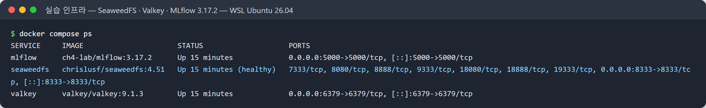

**책 코드는 접속 정보만 바꿨습니다.** `localhost:9000` → `localhost:8333`, `minio/minio123` → SeaweedFS 키, Redis 연결 문자열 → Valkey.
SeaweedFS와 Valkey가 각각 S3·Redis 프로토콜을 그대로 지원해서 **`minio` 파이썬 클라이언트, `boto3`, `s3fs`, `redis-py` 어느 것도 바꿀 필요가 없었습니다.**
노트북은 [`run_ch4_mlflow.py`](https://github.com/shyoon1991/mlops-study/blob/main/week02/lab/run_ch4_mlflow.py)로
문자열 치환만 한 뒤 그대로 실행했습니다(최신 버전에서 깨지는 곳이 그대로 드러나게).

## 도전과제 ③: Client → MLflow · Feast → 저장소, 동작 순서

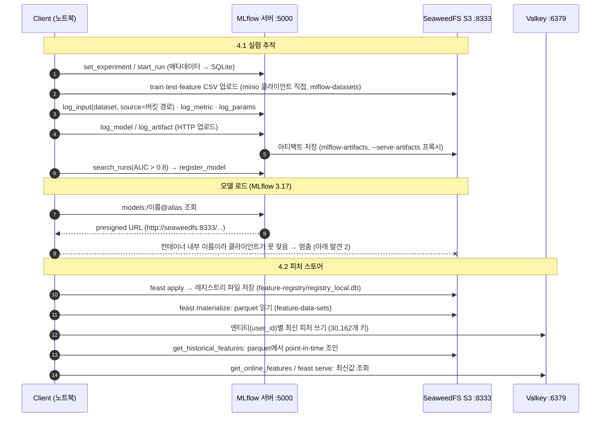

정리하면, **MLflow는 메타데이터(SQLite)와 아티팩트(S3)를 나눠 저장**하고, 업로드는 서버가 대신 해 주지만(프록시)
학습 데이터셋 CSV는 노트북이 S3에 직접 올립니다. **Feast는 별도 서버 없이 클라이언트 라이브러리가 S3와 Valkey를 직접 읽고 씁니다.**
`feast serve`를 띄워야 비로소 REST 엔드포인트가 생깁니다.

## 4.1 MLflow — 최신 버전에서 겪은 일

### 발견 1: 모델 저장이 실패했는데 레지스트리에는 READY로 등록됐다

책 노트북을 그대로 돌리자 결정 트리·랜덤 포레스트의 `mlflow.sklearn.log_model`에서 예외가 났습니다.

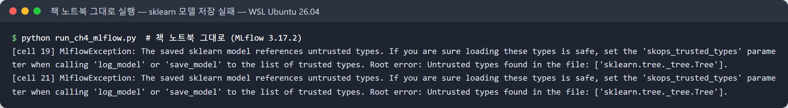

MLflow 3.17에서는 scikit-learn 모델 저장 형식이 **skops**로 바뀌면서, 모델 안에 든 타입이 "신뢰할 수 있는지" 검사합니다.
랜덤 포레스트의 트리 노드(`sklearn.tree._tree.Tree`)가 목록에 없어서 저장이 막혔습니다. 피클(pickle)을 그대로 불러오면 임의 코드가 실행될 수 있어서
생긴 보안 장치로 보입니다.

**문제는 그다음이었습니다.** 노트북 마지막 셀이 AUC가 가장 높은 run을 골라 `register_model`을 했는데, **에러 없이 버전 1이 등록**됐습니다.
`runs:/<run>/income-classifier` 경로에 아티팩트가 없자 MLflow 3의 `models:/m-...`(LoggedModel)로 대신 등록했다는 경고만 남겼습니다.

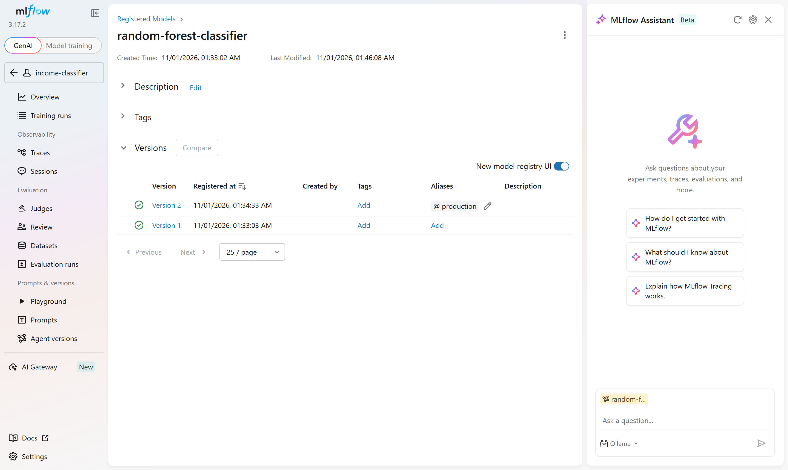

UI에서는 버전 1과 2가 똑같이 초록 체크(READY)지만, 실제로 불러 보면:

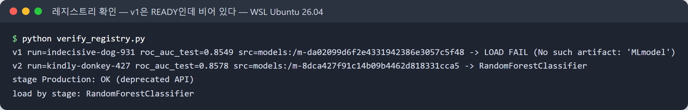

**버전 1은 `MLmodel` 파일조차 없는 빈 모델**입니다. run 목록을 보면 저장에 실패한 run(빨간 ✕)이 그대로 `random-forest-classifier v1`에 연결돼 있습니다.

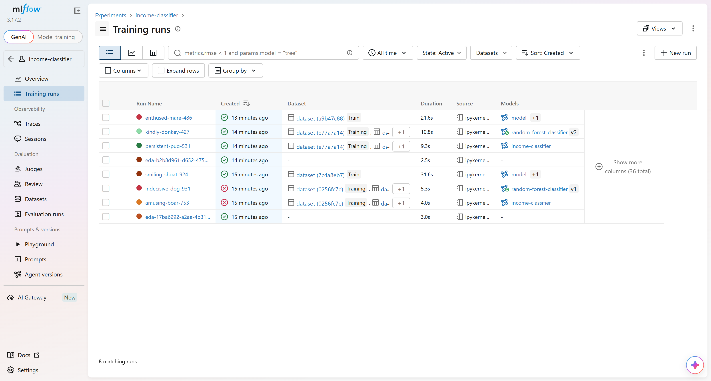

**해결**은 MLflow가 시키는 대로 신뢰 타입을 명시하는 것(그리고 deprecated된 `artifact_path` 대신 `name`)입니다.

```python
mlflow.sklearn.log_model(
    forest,
    name="income-classifier",
    skops_trusted_types=["sklearn.tree._tree.Tree", "sklearn.utils._bunch.Bunch"],
)
```

다시 돌리자 버전 2가 정상 등록됐고, 로드·예측까지 확인했습니다. 이 경험에서 얻은 교훈:

- **레지스트리의 READY는 "파일이 다 있다"는 뜻이 아니다.** 등록 직후 `load_model`로 한 번 불러 보는 검증 단계를 파이프라인에 넣어야 한다(5장 KFP라면 등록 다음 컴포넌트로).
- 실패한 run에서 모델을 고르지 않도록 `search_runs`에 `attributes.status = 'FINISHED'` 조건을 넣는 게 안전하다.

### 발견 2: 모델 로드가 멈춘다 — presigned URL이 컨테이너 내부 주소

버전 2를 `load_model`로 불러오자 이번에는 **아무 에러 없이 멈췄습니다.** 스레드 덤프를 떠 보니 `_multipart_download`에서 대기 중이었습니다.
MLflow 3.17 서버는 `/server-info`에 `multipart_downloads_enabled: true`를 알리고, 클라이언트는 서버에서 받은 **presigned URL로 S3에서 직접** 받으려 합니다.

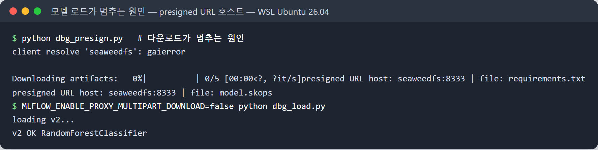

그 URL의 호스트가 `seaweedfs:8333` — **Compose 네트워크 안에서만 통하는 이름**이었습니다. 업로드는 MLflow 서버를 거쳐(프록시) 들어갔으니 아무 문제가 없다가,
다운로드만 클라이언트가 저장소로 직접 가려다 이름을 못 찾은 것입니다.

- 빠른 해결: 클라이언트에서 `MLFLOW_ENABLE_PROXY_MULTIPART_DOWNLOAD=false` → 서버 프록시로 받음, 41MB 모델이 1초 안에 로드
- 제대로 된 해결: 서버가 쓰는 S3 엔드포인트를 **클라이언트에서도 같은 이름으로 접근 가능한 주소**로 맞추기
  (K8s라면 Ingress 주소, 로컬이라면 둘 다 같은 호스트명)

책처럼 MinIO를 K8s 안에 두고 포트포워드로 접근하는 구성에서도 같은 문제가 생길 수 있어서, 5장 KFP 컴포넌트에서 모델을 불러올 때 참고할 만합니다.

### 발견 3: XGBoost 예제는 run 하나에 학습을 두 번 한다

`mlflow.xgboost.autolog()`를 켠 상태에서 책 코드가 `binary:logistic`과 `binary:hinge`로 두 번 학습해,
"Changing param values is not allowed" 오류가 납니다(강의에서도 같은 지적이 있었습니다). 지표도 두 번째 학습 것이 남습니다.

### 결과

| run | 모델 | ROC AUC (test) | 정확도 (test) | 비고 |
|---|---|---|---|---|
| persistent-pug-531 | 결정 트리 | 0.8232 | 0.8082 | |
| **kindly-donkey-427** | **랜덤 포레스트** | **0.8578** | 0.8152 | **레지스트리 v2, alias `@production`** |
| enthused-mare-486 | XGBoost | 0.7086 | 0.8152 | 두 번째(hinge) 학습 지표 |

5장 파이프라인은 `model_stage=Production`으로 모델을 찾습니다. MLflow 3에서 **stage는 deprecated**지만 아직 동작해서,
v2에 stage `Production`과 alias `production`을 둘 다 붙였습니다(`models:/random-forest-classifier/Production`, `@production` 모두 로드 확인).

## 4.2 Feast 0.67 + SeaweedFS + Valkey — 바꿀 게 거의 없었다

`feature_store.yaml`의 연결 문자열만 Valkey로 바꾸고 `feast apply` → `materialize` 순서로 진행했습니다.
0.40 → 0.67로 27개 마이너 버전을 건너뛰었지만, `Entity` 정의 방식에 대한 경고 하나 말고는 책 코드가 그대로 동작했습니다.

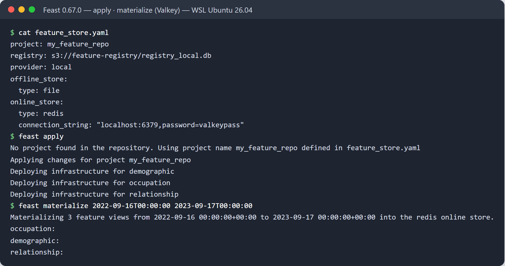

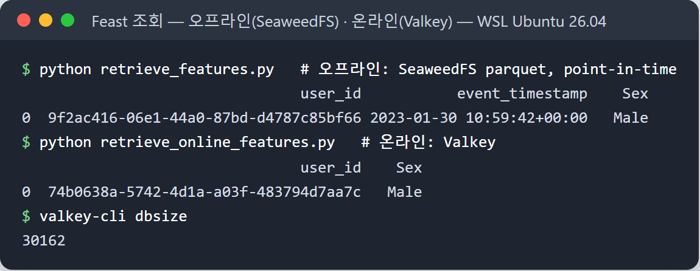

- 오프라인 조회는 `event_timestamp`(2023-01-30 10:59:42) 기준으로 **그 시점에 유효했던 값**을 parquet에서 찾아 붙입니다(point-in-time 조인).
- 온라인 조회는 타임스탬프 없이 **최신값**을 Valkey에서 바로 꺼냅니다.
- Valkey 키 수 **30,162** = 데이터 행 수. 엔티티(user_id) 하나에 키 하나(hash)로 저장합니다. 키 하나를 열어 보니 필드가 11개였습니다:
  피처 값 8개(필드 이름은 해시값)와 피처 뷰별 타임스탬프 3개(`_ts:demographic`, `_ts:occupation`, `_ts:relationship`).
- `feast serve`로 띄운 REST 엔드포인트(`/get-online-features`)도 같은 값을 돌려줬습니다.

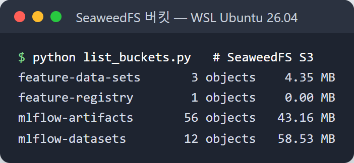

책에서 MinIO 버킷 4개에 들어가던 것이 SeaweedFS에 그대로 들어갔습니다.
최신 Kubeflow 배포판(Community Distribution)도 MinIO 대신 SeaweedFS를 쓴다는 강의 언급이 있었는데, S3 호환이라 옮기는 비용이 거의 없다는 걸 확인했습니다.

## 도전과제 ④: EDA `position='fill'` vs `'stack'`

책은 범주형 변수별로 소득(>50K) 비율을 `position='fill'` 막대그래프로 보여 줍니다. 기본값인 `'stack'`으로 바꾸면 비율 대신 건수가 쌓입니다.

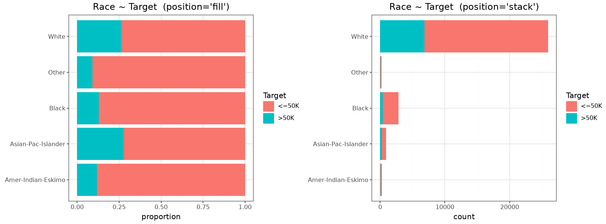

| Race | 건수 | >50K 비율 |
|---|---|---|
| White | 25,933 | 26.4% |
| Black | 2,817 | 13.0% |
| Asian-Pac-Islander | 895 | **27.7%** |
| Amer-Indian-Eskimo | 286 | 11.9% |
| Other | 231 | 9.1% |

- **fill**에서는 Asian-Pac-Islander의 >50K 비율(27.7%)이 White(26.4%)보다 높다는 게 바로 보입니다.
- **stack**에서는 White가 전체의 86%라 나머지 막대가 너무 작아 **비율 비교가 사실상 불가능**합니다.
- 대신 stack은 **표본이 얼마나 적은지**를 보여 줍니다. Other(231건)의 9.1%는 fill에서 다른 범주와 같은 크기의 막대로 그려져 과대평가하기 쉽습니다.

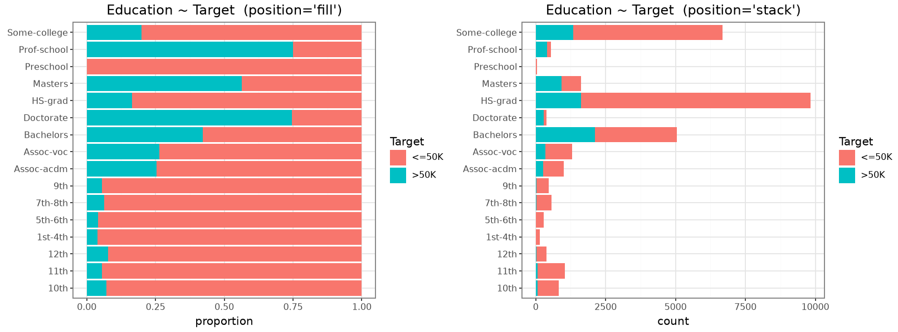

결론: **비율 비교는 fill, 표본 크기 확인은 stack.** EDA 단계에서 둘 다 보거나, fill 위에 건수를 텍스트로 붙이는 게 좋겠습니다.
모델 관점에서도, 건수가 적은 범주(예: Education의 Preschool은 45건, >50K 0%)는 원-핫 인코딩 후 학습에 거의 기여하지 못한다는 걸 stack이 알려 줍니다.

## 정리

| 도전과제 | 결과 |
|---|---|
| MLflow·Feast 최신 버전 | MLflow 3.17.2: 모델 저장 형식(skops)·다운로드 경로(presigned URL) 변경으로 **두 군데 수정 필요**. Feast 0.67.0: **수정 없음** |
| MinIO → SeaweedFS, Redis → Valkey | 접속 정보만 바꿔 **코드 수정 없이 동작**. 클라이언트 라이브러리도 그대로 |
| 동작 순서와 흐름 | 위 시퀀스 다이어그램. MLflow는 메타데이터와 아티팩트를 분리, Feast는 클라이언트가 저장소를 직접 다룬다 |
| EDA fill vs stack | 비율 비교는 fill, 표본 크기는 stack |

가장 크게 배운 것은 **"등록됨(READY)"과 "쓸 수 있음"은 다르다**는 점입니다. 1주차에 Harbor에서 태그가 덮어써지는 걸 봤는데,
레지스트리도 결국 이름표와 실체가 따로 놀 수 있습니다. 다음 주 BentoML 서빙으로 넘어가기 전에, 등록 직후 로드·예측을 검증하는 단계를 파이프라인에 넣어 볼 생각입니다.

---
- 실습 파일: [`week02/lab/`](https://github.com/shyoon1991/mlops-study/tree/main/week02/lab) — `compose.yaml`, 노트북 실행·검증 스크립트
- 책 코드: [practical-mlops/chapter-4](https://github.com/practical-mlops/chapter-4)
- 터미널 이미지는 실제 실행 출력을 캡처해 터미널 모양으로 렌더링한 것이고, MLflow 화면은 실제 웹 UI 스크린샷입니다.
