# BentoML 1.4 · Evidently 0.7로 6장 다시 하기 — 모든 요청에 같은 답을 하던 모델과, 윈도 50의 거짓 드리프트

> 머신러닝 플랫폼 엔지니어링 스터디 3주차 과제 (6·7장)
> 도전과제: ① 내부 도커 레지스트리 대신 **Harbor** ② Yatai 레지스트리 대체 도구 **KitOps** ③ 배포 모델의 `/metrics`를 **Prometheus**로 수집하고 **Grafana** 대시보드 만들기
> 덧붙여: 책의 BentoML 1.1.10 · Evidently 0.5.0 코드를 **최신 BentoML 1.4.40 · Evidently 0.7.23**으로 옮겼다

## 3주차에 배운 것

| 장 | 핵심 | 강의에서 강조한 것 |
|---|---|---|
| 6.1 BentoML | MLflow의 Production 모델을 BentoML 모델 스토어로 가져와 **Bento**(코드+모델 묶음, 컨테이너 이전 단계)로 빌드 → 컨테이너화 → 배포 | Yatai는 레지스트리·이미지 빌더(Kaniko)·배포(CRD) 세 부분. 2023년 이후 개발이 멈췄다. 빌더 파드 OOM(3GB→6GB) |
| 6.2 Evidently | reference(학습 때 데이터)와 current(최근 요청)를 통계 검정으로 비교해 **데이터 드리프트** 탐지, 대시보드·KFP 컴포넌트·API 서비스에 붙이기 | 레이블 드리프트·공변량 이동, KS·카이제곱·바서슈타인. 요청 1건마다가 아니라 **최근 N건 윈도**로 본다 — 강의에서는 윈도 50에서 드리프트 비율 0.875가 나왔다 |
| 7장 | 캡스톤(신분증 탐지·영화 추천) 데이터 준비, Kubeflow 노트북, KFP 데이터 전달 | 작은 값은 그대로, **큰 데이터는 경로(아티팩트)로** 넘긴다. 컴포넌트 함수 안에서 import |

## 실습 환경

2주차에 만든 Docker Compose 환경(MLflow 3.17.2 · SeaweedFS · Valkey · Feast 0.67)에 그대로 이어 붙였습니다. Kubernetes는 쓰지 않았습니다.

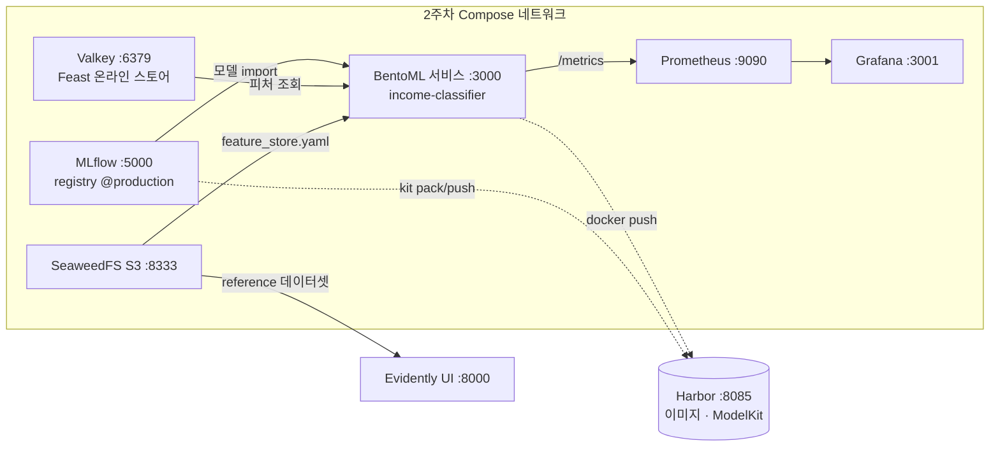

| 구성 | 책 | 이번 실습 |
|---|---|---|
| BentoML | 1.1.10 (Runner API) | **1.4.40** (`@bentoml.service` 클래스 API) |
| Evidently | 0.5.0 | **0.7.23** (API 전면 개편) |
| 레지스트리 | Yatai + 내부 `registry:2` | **Harbor 2.15** (1주차에 설치) + **KitOps 1.16** |
| 모니터링 | — | **Prometheus 3.15 + Grafana 13.2** |

## 1. 책 코드는 BentoML 1.4에서 시작조차 안 된다

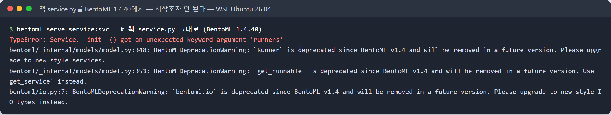

`bentoml.Service(runners=[...])`가 없어졌고, `Runner`·`bentoml.io`·`get_runnable`은 전부 deprecated입니다. 1.2부터 서비스 정의가 클래스 기반으로 바뀌었기 때문입니다.
요청·응답 형식(`{"user_id": ...}` → `{"income_category", "user_id"}`)은 그대로 두고 새 API로 옮겼습니다([`lab/service.py`](https://github.com/shyoon1991/mlops-study/blob/main/week03/lab/service.py)).

| 책 (1.1) | 1.4 |
|---|---|
| `svc = bentoml.Service("…", runners=[runner])` | `@bentoml.service` 클래스 |
| `bentoml.mlflow.get(...).to_runner()` | 클래스 속성 `bentoml.models.BentoModel(...)` → `__init__`에서 `bentoml.mlflow.load_model()` |
| `@svc.on_startup` + `ctx.state[...]` | `__init__` + 인스턴스 속성 |
| `@svc.api(input=JSON(pydantic_model=...))` | `@bentoml.api` + 인자 타입 힌트 |
| bentofile `docker.env` | 최상위 **`envs:`** (dict로 `docker.env`에 쓰면 컨테이너에 들어가지 않았다) |

강의에서 강조한 **Runner 분리**(API 파드와 추론 파드를 나눔)는 1.4에서 기본이 아닙니다. 모델이 API와 같은 프로세스에서 돕니다.
분리가 필요하면 추론을 별도 서비스로 만들고 `bentoml.depends()`로 연결합니다.

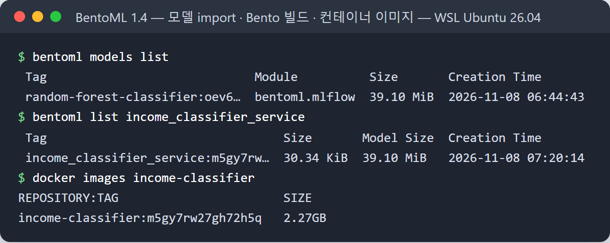

## 2. 발견: 모든 요청에 `<=50K` — 학습과 서빙의 전처리가 달랐다

컨테이너를 띄우고 목업 요청 200건을 보냈더니 **200건 전부 `<=50K`**였습니다. 데이터의 >50K 비율은 24.9%인데도요.
게다가 존재하지 않는 `user_id`에도 HTTP 200과 `<=50K`가 돌아왔습니다.

원인은 책의 `InputMapper`였습니다.

```python
pd.get_dummies(self.data, drop_first=True, ...)   # 책 src/data_mapper.py
```

학습 때는 3만 행에 이 함수를 썼으니 각 컬럼의 첫 범주만 빠졌지만, **서빙에서는 요청 1건 = 1행**입니다. 1행이면 각 컬럼에 범주가 하나뿐이라 `drop_first`가 **모든 더미를 지워** 버립니다.
그 뒤 `reindex(columns=학습 컬럼)`가 빈자리를 0으로 채우니, **어떤 사용자가 와도 모델은 똑같은 '전부 0' 입력**을 받고 있었습니다.

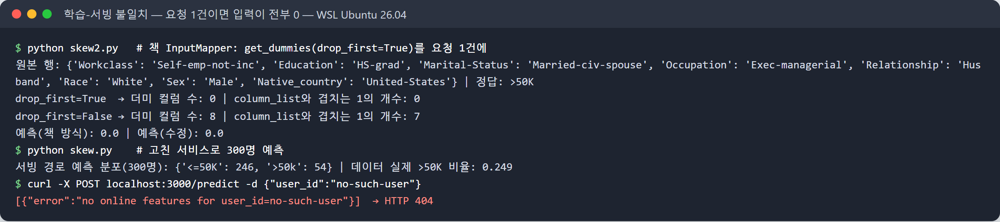

- 고친 방법: 서빙에서는 `drop_first=False`로 만든 뒤 학습 컬럼으로 `reindex`. 학습 때 버린 기준 범주는 컬럼 목록에 없으니 자연스럽게 빠집니다(8개 중 7개가 1, 하나는 기준 범주).
- 결과: 같은 300명 예측이 **`<=50K` 300 : `>50K` 0 → 246 : 54**
- 온라인 스토어에 피처가 없는 사용자는 이제 **404**(`bentoml.exceptions.NotFound`)

에러도 없이 그럴듯한 값을 돌려주는 종류의 버그라, **예측 분포를 모니터링하지 않으면 알아챌 방법이 없습니다.** 6.2의 드리프트 모니터링이 입력만 보고 출력은 보지 않는다는 점도 다시 생각하게 됐습니다.

## 3. 도전과제: Harbor + KitOps — Yatai 레지스트리 자리

Yatai가 하던 일 중 **"모델과 Bento를 저장하는 레지스트리"** 를 두 가지로 나눠 Harbor 한 곳에 모았습니다.

- **컨테이너 이미지**: `bentoml containerize`로 만든 이미지를 Harbor `mlops/income-classifier`에 push (강의의 내부 `registry:2` 대신)
- **ModelKit**: KitOps로 MLflow 모델(skops) + 서비스 코드를 **OCI 아티팩트 하나**로 묶어 같은 Harbor에 push

```yaml
# Kitfile
package: {name: income-classifier, version: 2.0.0}
model:   {name: random-forest-classifier, path: model, framework: scikit-learn, version: "2"}
code:    [{path: code, description: BentoML 1.4 service + feature store client}]
```

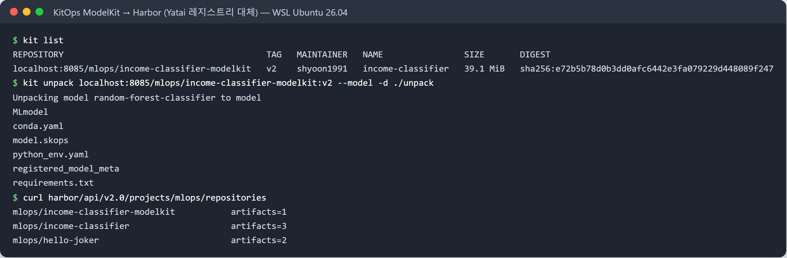

- `kit unpack --model`로 **모델만** 받을 수 있어서, 추론 서버는 39MB 모델만, 개발자는 코드까지 받는 식으로 나눌 수 있습니다.
- 이미지는 2.27GB인데 모델만 따로 버전 관리하면 모델이 바뀔 때 이미지를 다시 굽지 않아도 됩니다.
- 레지스트리가 하나(Harbor)라서 권한·보존 정책·복제를 이미지와 모델에 똑같이 적용할 수 있다는 점이 Yatai 대비 장점이었습니다.

## 4. 도전과제: `/metrics` → Prometheus → Grafana

BentoML은 서비스 포트(3000)의 `/metrics`에 요청 수·지연 히스토그램·처리 중 요청을 Prometheus 형식으로 내보냅니다(Feast 온라인 조회 지표도 같이 나옵니다).
Prometheus·Grafana를 같은 Compose 네트워크에 붙이고, 데이터 소스와 대시보드를 **파일로 프로비저닝**했습니다([`lab/monitoring/`](https://github.com/shyoon1991/mlops-study/tree/main/week03/lab/monitoring)).

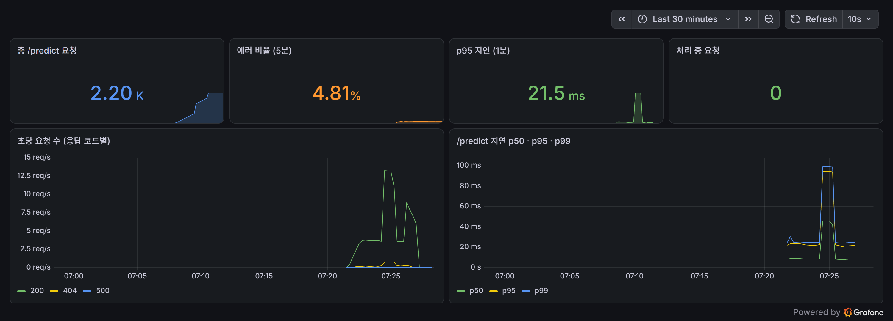

| 패널 | PromQL |
|---|---|
| 초당 요청 (응답 코드별) | `sum by (http_response_code) (rate(bentoml_service_request_total{endpoint="/predict"}[1m]))` |
| p50·p95·p99 지연 | `histogram_quantile(0.95, sum by (le) (rate(bentoml_service_request_duration_seconds_bucket{endpoint="/predict"}[1m])))` |
| 에러 비율 | 200이 아닌 요청 / 전체 (5분) |

목업 트래픽에 일부러 넣은 존재하지 않는 사용자 5%가 **에러 비율 4.81%(404)** 로 보이고, 동시 요청 4개 버스트 구간에서 **p99가 약 25ms → 100ms** 로 뛰는 게 보입니다.
2번의 버그가 그대로였다면 이 대시보드는 **에러 0%, 지연 정상**이었을 겁니다 — 운영 지표가 모델이 맞는지를 알려 주지는 않는다는 걸 확인한 셈입니다.

## 5. Evidently 0.7 — 그리고 윈도 50의 드리프트는 거짓 경보였다

책의 `evidently_reports.py`는 0.7.23에서 import부터 실패합니다(`ColumnDriftMetric` 없음). 대응표:

| 책 (0.5) | 0.7.23 |
|---|---|
| `from evidently.report import Report` | `from evidently import Report` (`run()`이 Snapshot을 돌려줌) |
| `DatasetDriftMetric()` | `DriftedColumnsCount()` |
| `ColumnDriftMetric(column_name=c)` | `ValueDrift(column=c)` |
| `DatasetMissingValuesMetric()` | `DatasetMissingValueCount()` |
| 예전 API 전체 | `evidently.legacy` 아래에 남아 있음 |

reference는 책 서비스와 같은 출처(MLflow Production run에 `reference_features`로 기록된 데이터셋)를 쓰고,
current는 **같은 분포에서 무작위로 뽑은 윈도**를 크기별로 넣어 봤습니다. 드리프트가 없어야 정상입니다.

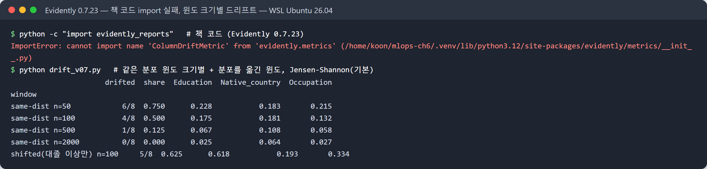

**드리프트가 전혀 없는 데이터인데 윈도 50에서 8개 중 6개 컬럼이 드리프트**로 나왔습니다(비율 0.75 ≥ 0.5 → 데이터셋 드리프트 판정).
강의에서 본 0.875가 바로 이 현상입니다. 원인은 reference가 1,000행을 넘으면 범주형에 쓰는 **Jensen-Shannon 거리(임계 0.1)** 가 작은 표본에서 크게 나오는 것.
Native_country(41개 범주)·Education(16개)처럼 범주가 많은 컬럼일수록 심합니다.

검정 방법을 바꿔 윈도 20개씩 반복해 봤습니다.

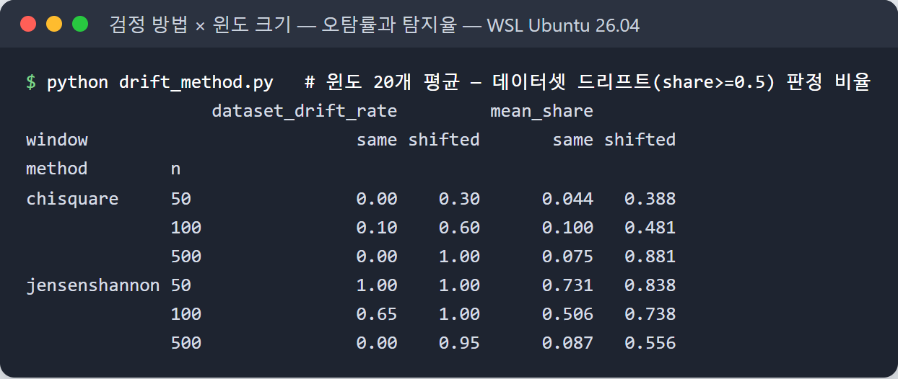

| 방법 | 윈도 | 같은 분포인데 드리프트 판정 (오탐) | 분포를 옮긴 윈도 탐지 |
|---|---|---|---|
| Jensen-Shannon (기본) | 50 | **100%** | 100% |
| Jensen-Shannon | 100 | 65% | 100% |
| Jensen-Shannon | 500 | 0% | 95% |
| 카이제곱 | 50 | **0%** | 30% |
| 카이제곱 | 100 | 10% | 60% |
| 카이제곱 | 500 | 0% | **100%** |

- 작은 윈도에 기본값(JS)을 쓰면 **모든 윈도가 드리프트**라서 경보가 의미가 없습니다.
- 카이제곱은 오탐이 거의 없지만 작은 윈도에서는 진짜 변화도 놓칩니다.
- 이 데이터에서는 **윈도 500 이상**이어야 두 방법 모두 쓸 만했습니다. 요청이 적은 서비스라면 윈도를 채우는 데 걸리는 시간이 곧 탐지 지연입니다.
- `DriftedColumnsCount(cat_method="chisquare")`처럼 **데이터셋 지표에 방법을 줘야** 합니다. 컬럼별 `ValueDrift(method=...)`만 바꾸면 데이터셋 판정은 그대로였습니다(처음에 이걸로 헤맸습니다).

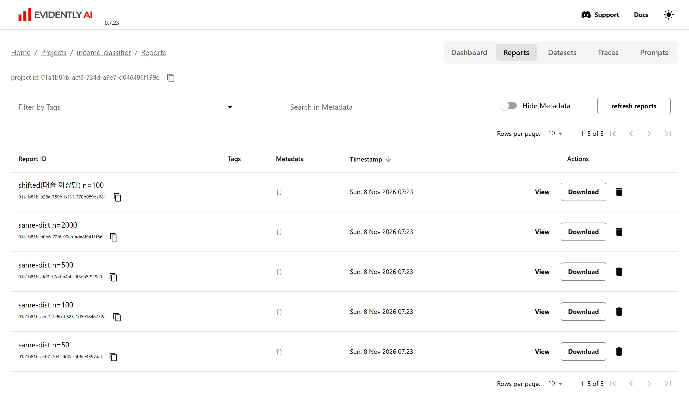

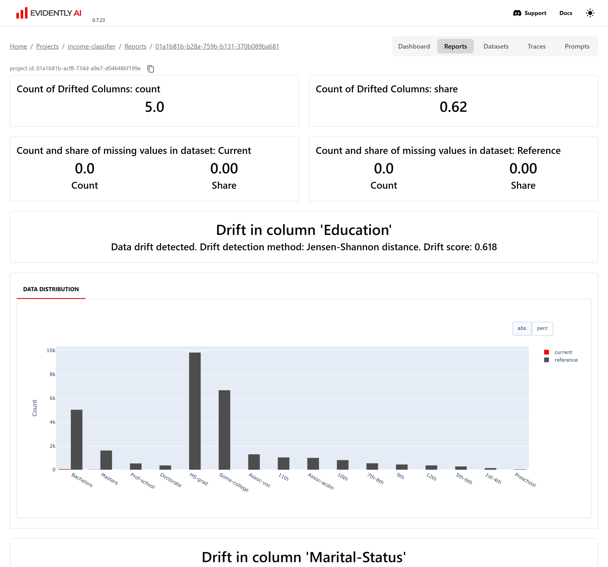

## 6. 덤: MLflow 데이터셋 출처가 다른 run의 파일을 가리킨다

reference 데이터셋을 찾으려고 Production 모델 run의 입력을 보다가 이상한 점을 발견했습니다.

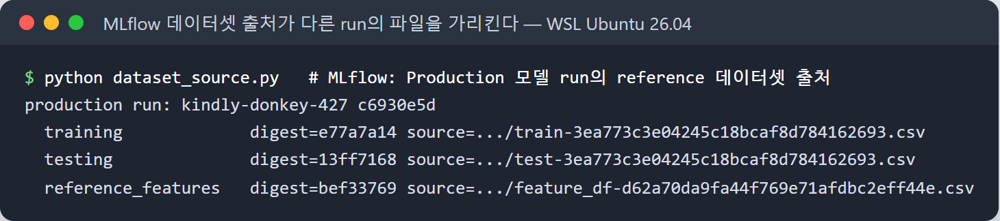

Production run(`c6930e5d`)의 training·testing·reference 데이터셋 `source`가 **전부 다른 run의 파일**(`3ea773c3`, `d62a70da`)을 가리킵니다.
같은 내용(digest)의 데이터셋은 MLflow가 레코드 하나로 재사용하면서 **처음 기록한 run의 source를 유지**하기 때문으로 보입니다.
내용은 같으니 지금은 문제가 없지만, 그 run의 파일을 정리하면 **Production 모델의 계보(lineage)가 끊깁니다.** 데이터셋은 run이 아니라 별도 경로(예: 데이터 버전)로 저장하는 게 안전하겠습니다.

## 그 밖에 막혔던 것

- **MLflow 3.x Host 헤더 검사**: 다른 컨테이너에서 `http://mlflow:5000`으로 부르자 `Invalid Host header - possible DNS rebinding attack detected`(403). 서버에 `--allowed-hosts "mlflow,mlflow:5000,localhost:5000,..."`를 줘야 합니다. 책처럼 K8s 서비스 이름으로 부를 때도 같은 설정이 필요합니다.
- **WSL 인스턴스가 쉬면 내려간다**: `wsl.exe` 세션이 없으면 Ubuntu가 내려가고 다음 명령에 새로 뜹니다(커널은 그대로라 `uptime`은 안 바뀜). 재시작 정책이 없는 컨테이너가 사라져 서비스 이름이 풀리지 않는 것처럼 보였습니다 → Compose에 `restart: unless-stopped`.

## 하지 않은 것

Kubernetes가 필요한 도전과제(Yatai CRD 배포, KServe, Kaniko 대체 이미지 빌더, 고급 스케줄링)는 이번에는 하지 않았습니다. 7장은 강의 진도(7.2 시나리오 1, 값 전달)까지 정리만 했고 실습은 4주차에 이어서 합니다.

## 정리

| 항목 | 결과 |
|---|---|
| BentoML 1.4 | 책 코드는 시작 불가 → 클래스 API로 옮김. bentofile `envs:` |
| 학습-서빙 불일치 | `get_dummies(drop_first=True)`를 1행에 → 모든 요청 같은 답. 300:0 → 246:54, 없는 사용자 404 |
| Harbor + KitOps | 이미지와 ModelKit(모델+코드)을 같은 레지스트리에. `kit unpack --model`로 모델만 |
| Prometheus + Grafana | 요청·에러·지연 대시보드를 파일로 프로비저닝. 운영 지표는 정상이어도 예측은 틀릴 수 있다 |
| Evidently 0.7 | 윈도 50 + Jensen-Shannon = 오탐 100%. 윈도 500 이상 또는 카이제곱 |

1주차 Harbor의 덮어써지는 태그, 2주차 READY인데 빈 모델에 이어 이번 주는 **200 OK인데 모두 같은 답**이었습니다.
세 주 연속으로 "겉으로는 정상"인 실패를 만났고, 그래서 모니터링 대상에 **예측 분포**를 넣는 걸 다음 목표로 잡았습니다.

---
- 실습 파일: [`week03/lab/`](https://github.com/shyoon1991/mlops-study/tree/main/week03/lab)
- 책 코드: [practical-mlops/chapter-6](https://github.com/practical-mlops/chapter-6)
- 터미널 이미지는 실제 실행 출력을 캡처해 터미널 모양으로 렌더링한 것이고, Grafana·Evidently 화면은 실제 웹 UI 스크린샷입니다.
