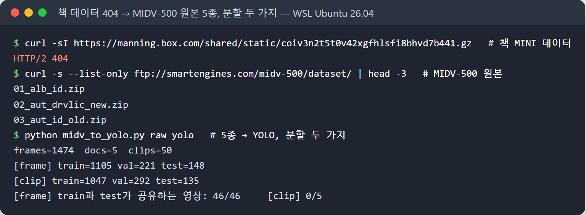
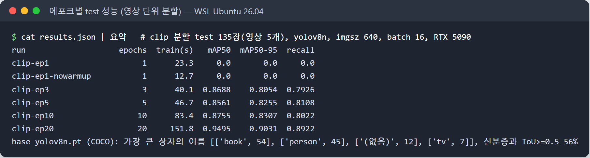
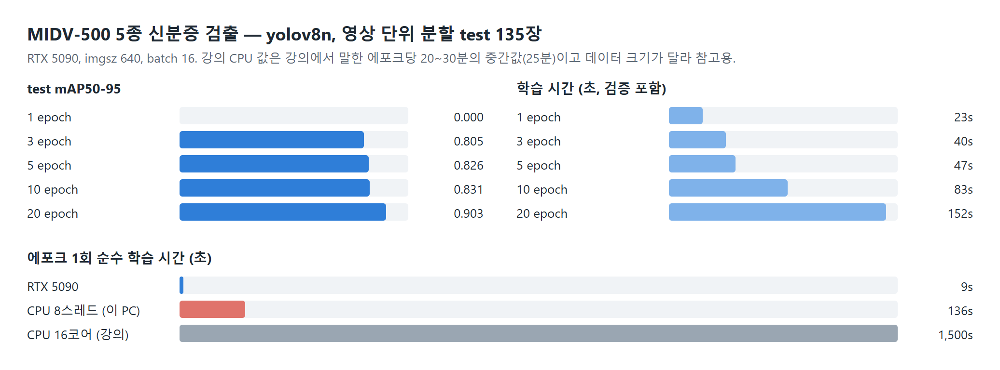
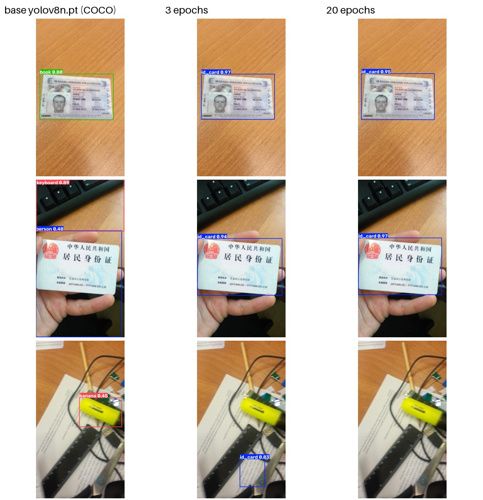
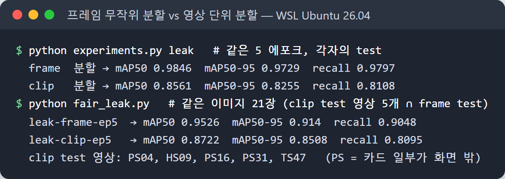
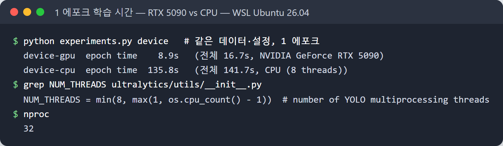
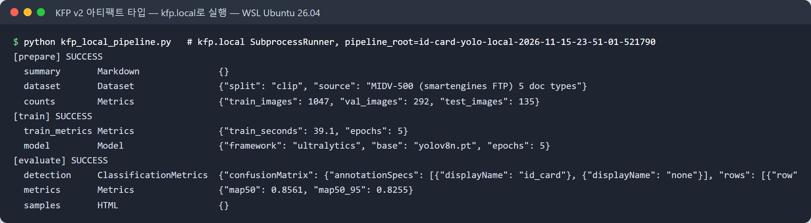

# 책 데이터가 사라진 8장 — MIDV-500 원본으로 YOLO를 다시 학습하며 본 에포크·GPU·데이터 분할

> 머신러닝 플랫폼 엔지니어링 스터디 4주차 과제 (7·8·9장)
> 도전과제: ① 책 원본 대신 **외부 공개 데이터셋**으로 데이터 준비 ② **기본 가중치 vs 에포크 1·5·그 이상** 객체 탐지 성능 비교 (8.1.7) ③ **NVIDIA GPU**로 학습하고 속도 비교 ④ **KFP v2 아티팩트 타입**을 고루 쓰는 컴포넌트

## 4주차에 배운 것

| 장 | 핵심 | 강의에서 강조한 것 |
|---|---|---|
| 7.2 데이터 전달 | 컴포넌트는 각자 격리된 파드 → 큰 데이터를 **값으로 넘기면 OOM·반복 복사**, **경로(아티팩트)로** 넘긴다 | 아티팩트 타입별 용도: Dataset·Model·Metrics·ClassificationMetrics·HTML·Markdown·Artifact |
| 7.3 데이터 준비 | 신분증 탐지(MIDV-500 → YOLO 형식, 75/15/10 분할), 영화 추천(MovieLens 25M → parquet, QA) | 강사 환경에서 다운로드만 15~16분, SeaweedFS `volume.max` 기본값(100 × 64MB) 때문에 용량 부족 |
| 8장 학습·검증 | `yolov8n.pt`를 id_card 한 클래스로 파인튜닝, 검증 컴포넌트로 지표를 남기고 통과해야 서빙 | 경량 / `target_image` / `@dsl.container_component` 세 방식의 차이. 강사는 **CPU 16코어로 에포크당 20~30분**, epochs 3에 1시간 20분 |
| 9.1 PVC | 객체 저장소 대신 PVC를 마운트하면 업·다운로드와 경로 인자 6개가 사라진다 | 외부 리소스라 `.after()`로 순서 지정 |

## 1. 책 데이터 링크가 죽어 있었다 → MIDV-500 원본에서 다시

책 코드(`object-detection-project`)의 신분증 데이터는 Manning box.com 링크(MINI·FULL)에서 받는데, **두 링크 모두 404**였습니다.
데이터의 원본인 **MIDV-500**(신분증 50종을 10가지 장면에서 촬영한 영상 500개, 영상당 30프레임, 프레임마다 문서 네 꼭짓점 좌표)은
제작사 FTP에 그대로 남아 있어서, 종류별 zip(약 650MB, 전체 약 33GB) 중 **5종만** 받았습니다.

| 고른 5종 | 형태 |
|---|---|
| 04 오스트리아 ID, 09 중국 ID | 신분증 카드 |
| 16 독일 여권(신형) | 여권 면 |
| 31 일본 운전면허 | 면허증 |
| 47 미국 국경 통과 카드 | 카드 |

FTP가 중간에 자주 끊겨서(curl 56) **이어받기(`curl -C -`)를 될 때까지 반복**하는 스크립트로 받았습니다([`lab/dl_midv.sh`](https://github.com/shyoon1991/mlops-study/blob/main/week04/lab/dl_midv.sh)).
네 꼭짓점(quad)을 감싸는 상자를 YOLO 라벨(`0 cx cy w h`)로 바꾸고, 카드가 거의 화면 밖인 프레임은 버렸습니다([`lab/midv_to_yolo.py`](https://github.com/shyoon1991/mlops-study/blob/main/week04/lab/midv_to_yolo.py)).

여기서 **분할을 두 가지로** 만들었습니다.

- **frame**: 책 `split_dataset`처럼 프레임을 무작위로 75/15/10
- **clip**: **영상 단위**로 나눠, test 영상의 프레임은 학습에 한 장도 쓰지 않음

MIDV-500은 한 영상의 연속 프레임 30장이라 이웃 프레임끼리 거의 같습니다. frame 분할에서는 **test 영상 46개 전부가 train에도** 들어가 있었습니다.

## 2. 도전과제: 기본 가중치 vs 에포크 1·3·5·10·20 (8.1.7)

책 8장과 같은 호출(`YOLO("yolov8n.pt").train(imgsz=640, ...)`)로, **영상 단위 분할**에서 에포크만 바꿔 학습하고 test 135장(영상 5개)으로 쟀습니다([`lab/experiments.py`](https://github.com/shyoon1991/mlops-study/blob/main/week04/lab/experiments.py)).

- **기본 `yolov8n.pt`(COCO)** 에는 id_card 클래스가 없습니다. 가장 큰 상자를 보면 신분증을 **`book` 54장, `person` 45장**으로 봤고(강의에서 본 것과 같음), 그 상자가 신분증과 IoU 0.5 이상 겹친 건 56%뿐이었습니다.
- **3 에포크에서 이미 mAP50 0.87**, 20 에포크에서 0.95(mAP50-95 0.90). 3→10 에포크 구간은 거의 평평하고 20에서 다시 올랐습니다. test가 영상 5개뿐이라 이 정도 흔들림은 표본 탓일 수 있습니다.
- 위 그림 셋째 줄(카드 대부분이 화면 밖인 장면)에서 3 에포크는 엉뚱한 곳에 상자를, 20 에포크는 아무것도 내지 않았습니다. 이 프레임의 정답 상자는 **왼쪽 끝 126px 폭의 띠**인데,
  꼭짓점이 화면 밖으로 나간 카드를 화면 안으로 잘라 만든 라벨이라 정답 정의 자체가 애매합니다 — 라벨 변환 규칙도 모델 성능의 일부라는 걸 확인했습니다.

### 1 에포크만 학습하면 mAP 0

1 에포크 모델은 **test에서 아무것도 찾지 못했습니다**(mAP 0, 최대 confidence 0.0000). 워밍업 탓인지 보려고 `warmup_epochs=0`으로 다시 해도 0이었습니다.
그런데 **3 에포크 학습의 첫 에포크는 이미 val mAP50 0.72**였습니다. 같은 "1 에포크째"인데 총 에포크 수에 따라 결과가 갈린 것이고, 첫 에포크의 분류 손실도 8.96 vs 1.77로 달랐습니다.
Ultralytics의 학습률 스케줄·최소 워밍업 반복 수(100 iteration)가 전체 에포크 수에 묶여 있는 것이 의심되지만 **원인을 끝까지 확인하지는 못했습니다.**
"에포크 1 vs 5 비교"를 할 때는 **"1 에포크만 학습한 모델"과 "긴 학습의 1번째 에포크"가 다르다**는 점을 알아 둘 만합니다.

## 3. 발견: 프레임 무작위 분할은 성능을 부풀린다 — 다만 생각보다 작게

같은 5 에포크로 두 분할을 학습해 각자의 test로 재면 **frame 0.973 vs clip 0.826 (mAP50-95), 15점 차이**입니다.

그런데 확인해 보니 clip 분할의 test 영상 5개 중 3개가 **PS(카드 일부가 화면 밖) 장면**이었습니다. 무작위로 고른 영상이 하필 어려운 장면이었던 겁니다.
그래서 **같은 이미지**(clip test 영상에 속하면서 frame test에도 든 21장)로 두 모델을 다시 쟀습니다([`lab/fair_leak.py`](https://github.com/shyoon1991/mlops-study/blob/main/week04/lab/fair_leak.py)).

| 같은 21장에서 | mAP50-95 | 그 영상을 학습 때 봤나 |
|---|---|---|
| frame 분할로 학습 | **0.914** | 같은 영상의 다른 프레임을 봤다 |
| clip 분할로 학습 | 0.851 | 한 장도 안 봤다 |

- **누수만의 효과는 약 6점**이고, 처음 본 15점 차이의 나머지 9점은 **test 장면이 달라서** 생긴 것이었습니다. (21장이라 오차가 큰 숫자입니다.)
- 교훈은 두 가지입니다. 영상·사용자·세션처럼 **묶음이 있는 데이터는 묶음 단위로 분할**해야 하고, 묶음 단위로 나눌 때는 **test 묶음의 구성(장면·종류)을 층화**해야 합니다. 책의 `train_test_split` 두 번 호출은 둘 다 놓칩니다.

## 4. 도전과제: GPU로 학습 — RTX 5090 vs CPU

WSL2 Ubuntu의 PyTorch 2.9.1+cu130이 RTX 5090(sm_120)을 바로 인식했습니다. 같은 데이터·설정으로 1 에포크만 돌린 순수 학습 시간입니다.

| 장치 | 에포크 1회 | 비고 |
|---|---|---|
| RTX 5090 | **8.9초** | |
| CPU (Ryzen 9 9950X) | 135.8초 | **약 15배 느림** |
| 강의 (CPU 16코어, 책 데이터) | 20~30분 | 데이터가 훨씬 커서 직접 비교는 아님 |

- CPU 쪽은 32코어 중 **8스레드만** 썼습니다. Ultralytics가 `NUM_THREADS = min(8, cpu_count - 1)`로 상한을 둡니다. 즉 "CPU 학습이 느리다"의 일부는 라이브러리 기본값입니다.
- 20 에포크 전체가 GPU로 152초 — 강의 환경의 1 에포크보다 짧습니다. 에포크를 늘리는 실험을 마음껏 할 수 있느냐가 GPU의 실제 가치였습니다.
- 책의 K8s 환경이었다면 NVIDIA GPU Operator(또는 device plugin)로 `nvidia.com/gpu` 리소스를 노출하고 학습 컴포넌트에 `.set_accelerator_type(...).set_accelerator_limit(1)`을 붙이는 단계가 추가됩니다. 이번에는 K8s 없이 Docker와 같은 NVIDIA 런타임을 쓰는 WSL에서 직접 돌렸습니다.

## 5. 도전과제: KFP v2 아티팩트 타입을 고루 쓰는 파이프라인 — `kfp.local`로

Kubeflow 클러스터 없이도 KFP SDK 2.x에는 **로컬 실행기**(`kfp.local.SubprocessRunner`)가 있어서, 같은 `@dsl.component`·`@dsl.pipeline` 코드를 그대로 돌릴 수 있습니다.
prepare → train → evaluate 세 컴포넌트에 **아티팩트 타입 6가지**를 붙였습니다([`lab/kfp_local_pipeline.py`](https://github.com/shyoon1991/mlops-study/blob/main/week04/lab/kfp_local_pipeline.py)).

| 컴포넌트 | 출력 | 타입 |
|---|---|---|
| prepare | YOLO 데이터셋 디렉터리 / 분할 요약 표 / 장수 | `Dataset` / `Markdown` / `Metrics` |
| train | `best.pt` / 학습 시간 | `Model` / `Metrics` |
| evaluate | mAP / 이미지별 검출·놓침 혼동행렬 / 예측 샘플 | `Metrics` / `ClassificationMetrics` / `HTML` |

로컬에서 돌리며 두 번 막혔습니다.

1. **`No module named pip`**: 로컬 실행기도 컴포넌트를 시작할 때 `pip install kfp==…`를 합니다. `uv`로 만든 가상환경에는 pip이 없어서 실패 → 가상환경에 pip을 넣어 해결.
2. **`model=.../train/model is not a supported model format`**: `Output[Model]`의 경로는 **확장자 없는 파일 이름**인데, Ultralytics는 확장자(`.pt`)로 형식을 판단합니다.
   → 아티팩트 경로를 **디렉터리로 쓰고 그 안에 `best.pt`** 를 두는 방식으로 바꿨습니다. 책의 `Output[Model]` 예제를 다른 프레임워크로 옮길 때 그대로 만날 문제입니다.

결과는 단독 실행의 5 에포크와 같은 mAP50 0.856이었고, 135장 중 112장에서 신분증을 하나 이상 찾았습니다.

## 하지 않은 것

- KCD(Kubeflow Community Distribution)·PVC(9.1)·TensorBoard(9.2)처럼 **Kubernetes가 필요한 실습**은 하지 않았습니다. 7.3.2 영화 추천 데이터 준비도 이번에는 정리만 했습니다.
- MIDV-500은 50종 중 5종(1,474프레임)만 썼습니다. 책·강의의 데이터 규모와 다르므로 숫자는 이 조건에서만 의미가 있습니다.

## 정리

| 항목 | 결과 |
|---|---|
| 책 데이터 | Manning 링크 404 → MIDV-500 원본 FTP(이어받기 필요), 5종 1,474프레임 |
| 기본 vs 학습 | COCO 모델은 신분증을 `book`·`person`으로 본다. 3 에포크 mAP50 0.87, 20 에포크 0.95 |
| 1 에포크 | "1 에포크만 학습"은 mAP 0, "3 에포크 학습의 1번째"는 0.72 — 같지 않다 |
| 데이터 분할 | 프레임 무작위 분할은 같은 이미지 기준 약 6점 부풀린다. test 장면 구성 차이도 9점 |
| GPU | 에포크당 8.9초 vs CPU 135.8초(15배). CPU는 Ultralytics가 8스레드로 제한 |
| KFP 아티팩트 | `kfp.local`로 6가지 타입. `Output[Model]`은 확장자 없는 경로 → 디렉터리로 |

1~3주차는 "겉으로는 정상인데 실제로는 틀린" 결과(덮어써진 태그, 빈 모델, 모두 같은 답)였다면, 이번 주는 **"숫자가 맞게 나왔는데 그 숫자가 무엇을 재는지"** 의 문제였습니다.
같은 mAP라도 어떻게 나눈 test인지, 몇 에포크 학습의 몇 번째인지에 따라 뜻이 달라졌습니다.

---
- 실습 파일: [`week04/lab/`](https://github.com/shyoon1991/mlops-study/tree/main/week04/lab) — 결과 원본 `results.json` 포함
- 책 코드: [practical-mlops/object-detection-project](https://github.com/practical-mlops/object-detection-project)
- 데이터: MIDV-500 (Arlazarov et al., 2018, smartengines FTP) — 5종만 사용
- 터미널 이미지는 실제 실행 출력을 캡처해 터미널 모양으로 렌더링한 것이고, 예측 격자·HTML 아티팩트는 실제 모델 출력입니다.
